# OpenMU Aurora

*[Wersja polska](README.pl.md)*

A modern WordPress block theme for [OpenMU](https://github.com/MUnique/OpenMU) (MU Online server
emulator) websites. Night sky over snowy peaks and a floating citadel, animated northern lights,
frosted-glass panels, thin silver lines and large painted artwork.

It is made for the **[OpenMU WP Connect](https://github.com/nolt/openmu-wp-connect)** plugin, which brings the live
server data (status, rankings, armory, events, account). Without the plugin the theme works as a site with news,
and the server pages say that the plugin is needed.

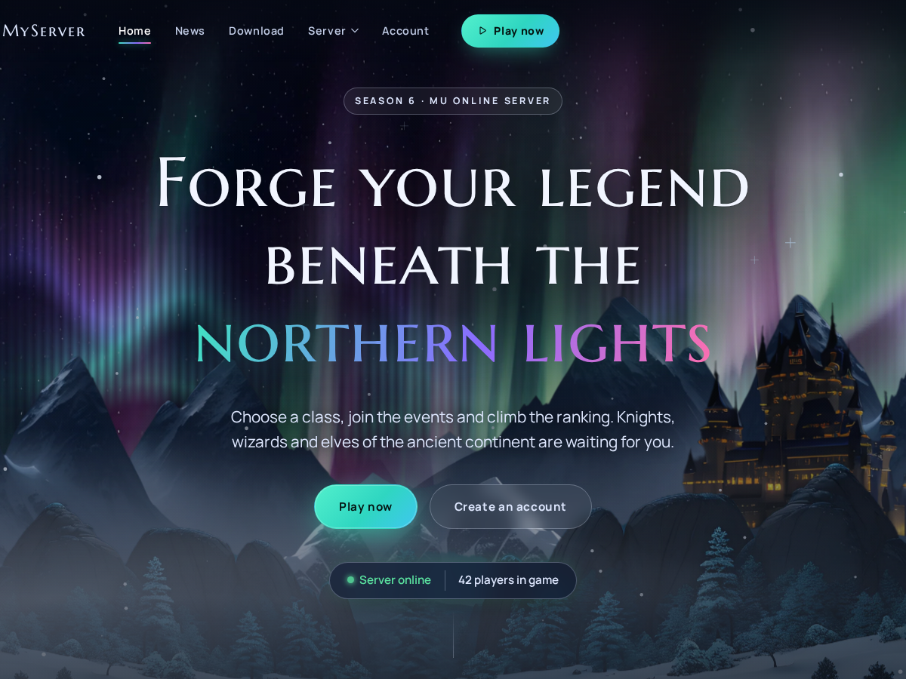

## Features

- Full-screen home page: painted parallax scenery, animated aurora ribbons, drifting snow and
  sparkles, live server status, interactive showcase of the seven classes, latest news, how to start,
  events teaser, top 5 ranking, community banner and a rich footer.
- Calmer animated background on every other page. `prefers-reduced-motion` shows a static poster;
  the animation pauses while the tab is hidden; one small deferred vanilla script.
- Fixed header menu: Home, News, Download, **Server** (Ranking, Mini games, Armory, Events,
  Commands) and Account, plus a *Play now* button. Sticky and compact on scroll, the dropdown works
  with the mouse, the keyboard and touch, full-screen overlay on phones.
- Styles for every [OpenMU WP Connect](https://github.com/nolt/openmu-wp-connect) block: server
  status, ranking, mini game ranking, events, armory and account.
- Templates for the news archive, single post, pages, ranking, mini games, armory, events,
  commands (table of the common OpenMU chat commands), download, account, search and 404.
- Fonts are bundled (Marcellus SC and Manrope, SIL OFL): no external requests at runtime.
- Translatable; Polish translation included.

## Requirements

- WordPress 6.6 or later (tested with 7.1), PHP 8.1 or later (tested with 8.4).
- Optional: the [OpenMU WP Connect](https://github.com/nolt/openmu-wp-connect) plugin, for live data from the game server.

## Installation

1. Download `openmu-aurora-<version>.zip` from [Releases](../../releases) and upload it under
   **Appearance > Themes > Add New Theme > Upload Theme**, or copy this repository to
   `wp-content/themes/openmu-aurora`. Activate **OpenMU Aurora**.
2. Install the [OpenMU WP Connect](https://github.com/nolt/openmu-wp-connect) plugin and connect it to your server.
3. Set the real links: the buttons on the **Download** page and the Discord links (they point to `#` until you do).

Optional: `add_filter( 'openmu_aurora_discord_url', fn() => 'https://...' );` in a small plugin or a child
theme shows a Discord button in the footer.

## What activating does

Activating the theme creates the pages it needs by address (Home, News, Download, Ranking, Mini games, Armory,
Events, Commands, Account), makes Home the front page and News the posts page, and restores your previous
reading settings when you switch to another theme. Pages with other addresses are left alone.

## Game client files

The theme ships no files of the MU Online game client. The armory therefore shows the plugin's neutral class
emblem and the item names. To show class pictures and full item tooltips, put the files from your own game client
into the plugin's client folder, as its README describes.

## Pages

With the plugin in demo mode, desktop 1440 px wide. Click a picture for the full size.

| | | |
| --- | --- | --- |
| [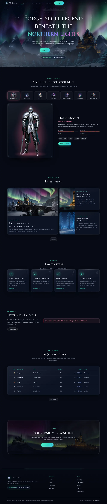](docs/assets/pages/home.webp) Front page | [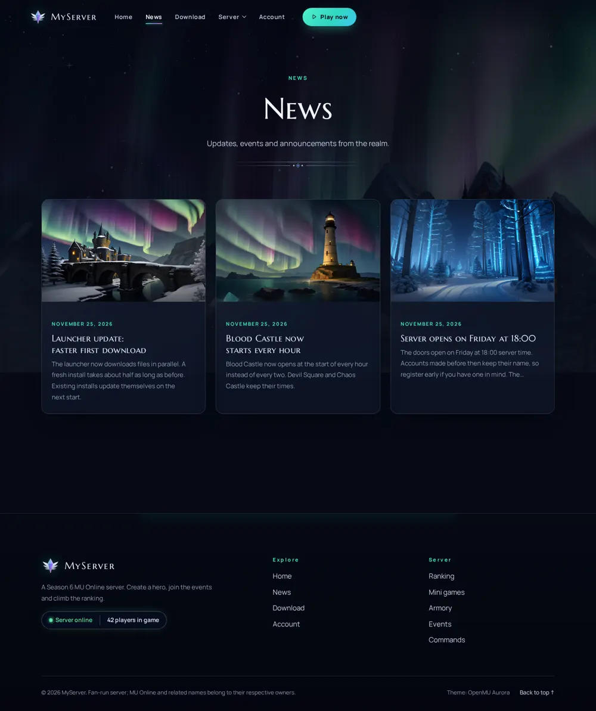](docs/assets/pages/news.webp) News | [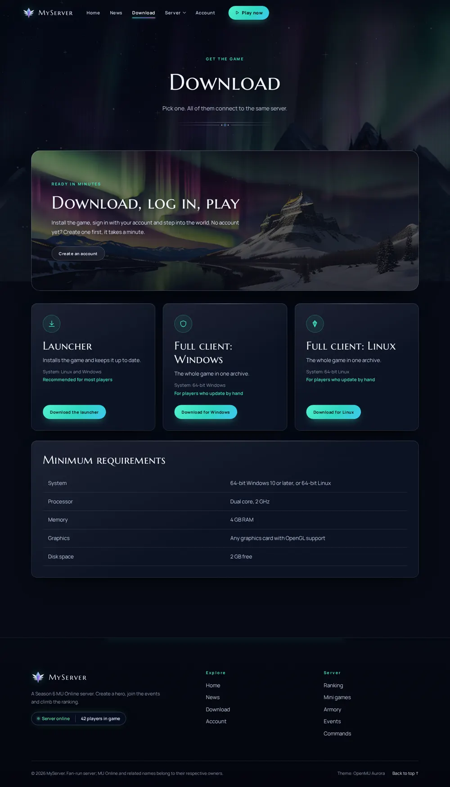](docs/assets/pages/download.webp) Download |
| [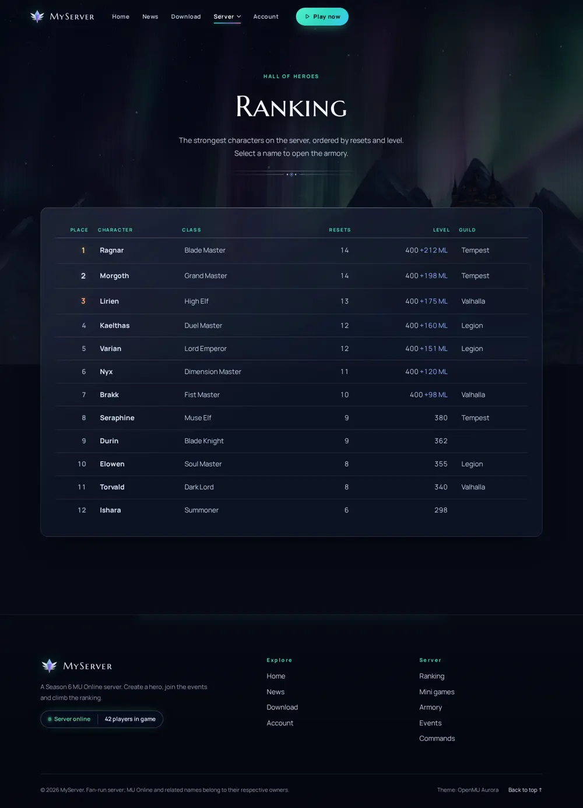](docs/assets/pages/ranking.webp) Ranking | [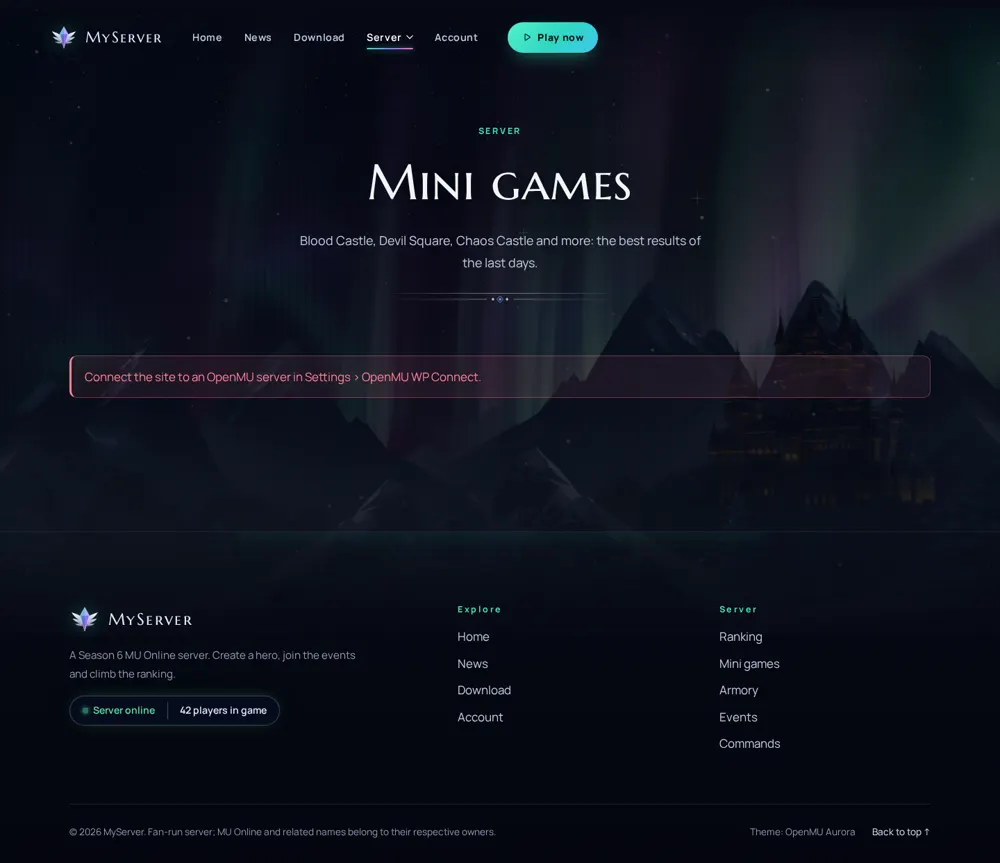](docs/assets/pages/mini-games.webp) Mini games | [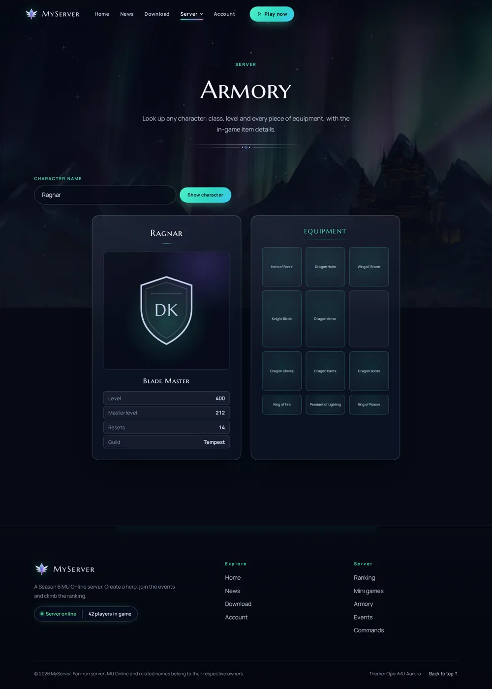](docs/assets/pages/armory.webp) Armory |
| [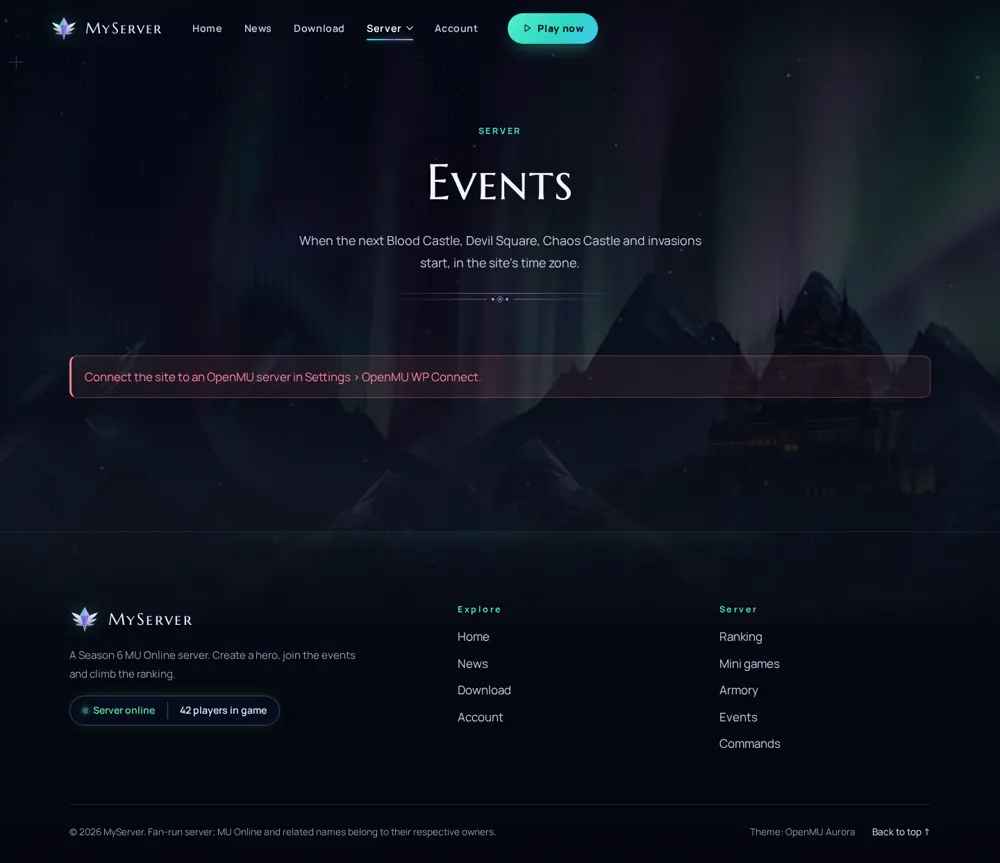](docs/assets/pages/events.webp) Events | [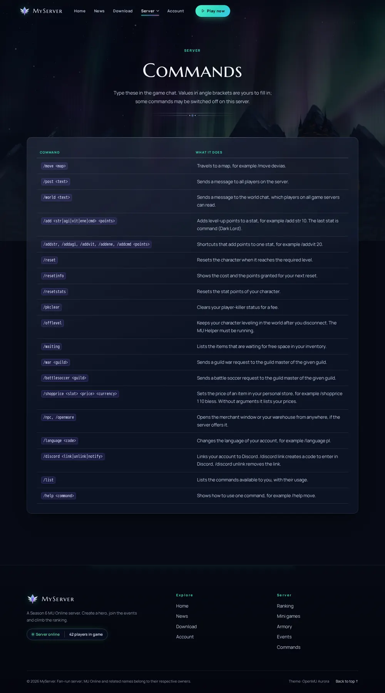](docs/assets/pages/commands.webp) Commands | [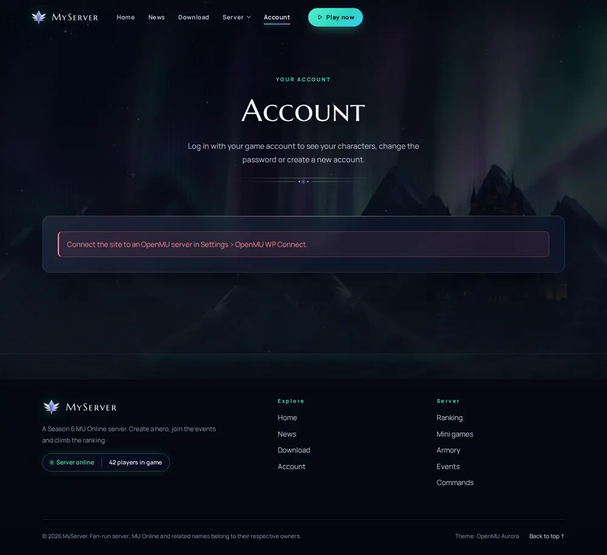](docs/assets/pages/account.webp) Account |

| | | |
| --- | --- | --- |
| [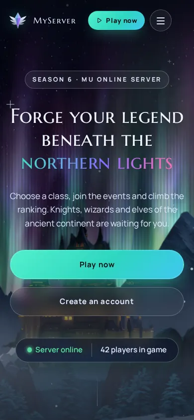](docs/assets/pages/phone-home.webp) Front page | [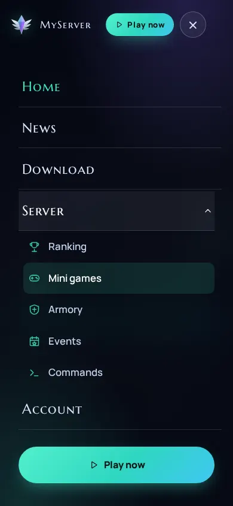](docs/assets/pages/phone-menu.webp) Menu | [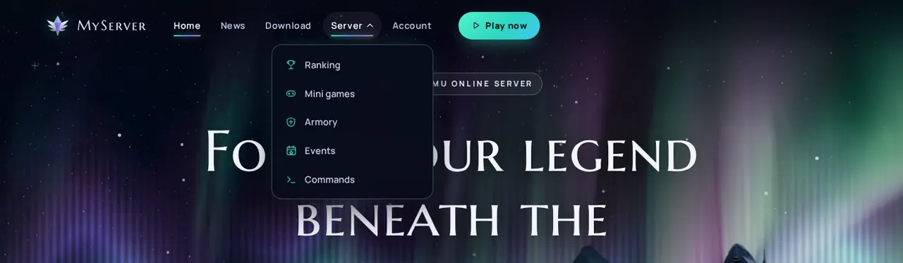](docs/assets/pages/menu-desktop.webp) Server menu (desktop) |

## Artwork and credits

The painted artwork was generated for this theme with the DreamShaper 8 model (CreativeML
OpenRAIL-M) and upscaled with Real-ESRGAN; how, with which settings and under which licences is
described in [`assets/art/README.md`](assets/art/README.md). Logo, icons and ornaments are hand-written SVG.
Fonts: Marcellus SC and Manrope, SIL Open Font License 1.1 (`assets/fonts/`).

MU Online is a trademark of Webzen. This project is a fan work, not affiliated with or endorsed by Webzen.

## License

GPL-2.0-or-later. Copyright (c) 2026 Nolt.
