# OpenMU Aurora

*[English version](README.md)*

Nowoczesny blokowy motyw WordPress dla stron serwerów [OpenMU](https://github.com/MUnique/OpenMU)
(emulator serwera MU Online). Nocne niebo nad zaśnieżonymi szczytami i latającą cytadelą,
animowana zorza polarna, szklane panele, cienkie srebrne linie i duże malowane grafiki.

Motyw powstał do wtyczki **[OpenMU WP Connect](https://github.com/nolt/openmu-wp-connect)**, która dostarcza dane
serwera na żywo (status, rankingi, zbrojownia, wydarzenia, konto). Bez wtyczki motyw działa jako strona
z aktualnościami, a strony serwera informują, że wtyczka jest potrzebna.

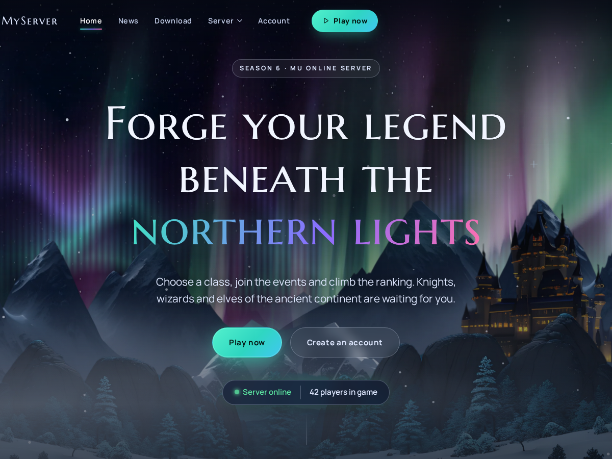

## Funkcje

- Pełnoekranowa strona główna: malowany krajobraz z paralaksą, animowane wstęgi zorzy, padający
  śnieg i iskry, status serwera na żywo, interaktywna prezentacja siedmiu klas, najnowsze aktualności,
  jak zacząć, zapowiedź wydarzeń, top 5 rankingu, baner społeczności i rozbudowana stopka.
- Spokojniejsze animowane tło na pozostałych stronach. Przy `prefers-reduced-motion` widać
  statyczny plakat; animacja zatrzymuje się, gdy karta jest ukryta; jeden mały skrypt vanilla.
- Stałe menu: Start, Aktualności, Pobierz, **Serwer** (Ranking, Mini gry, Zbrojownia, Wydarzenia,
  Komendy) i Konto oraz przycisk *Graj teraz*. Przyklejone, zmniejsza się po przewinięciu, podmenu
  działa myszą, z klawiatury i dotykiem, na telefonie pełnoekranowa nakładka.
- Style wszystkich bloków wtyczki [OpenMU WP Connect](https://github.com/nolt/openmu-wp-connect):
  status serwera, ranking, ranking mini gier, wydarzenia, zbrojownia i konto.
- Szablony: archiwum aktualności, wpis, strona, ranking, mini gry, zbrojownia, wydarzenia,
  komendy (tabela popularnych komend czatu OpenMU), pobieranie, konto, wyszukiwarka i 404.
- Czcionki w paczce (Marcellus SC i Manrope, SIL OFL): żadnych zewnętrznych zapytań.
- Tłumaczalny; polskie tłumaczenie w zestawie.

## Wymagania

- WordPress 6.6 lub nowszy (testowane z 7.1), PHP 8.1 lub nowszy (testowane z 8.4).
- Opcjonalnie: wtyczka [OpenMU WP Connect](https://github.com/nolt/openmu-wp-connect), dla danych z serwera gry na żywo.

## Instalacja

1. Pobierz `openmu-aurora-<wersja>.zip` z [Releases](../../releases) i wgraj w **Wygląd > Motywy > Dodaj nowy motyw >
   Wyślij motyw na serwer** albo skopiuj to repozytorium do `wp-content/themes/openmu-aurora`. Włącz **OpenMU Aurora**.
2. Zainstaluj wtyczkę [OpenMU WP Connect](https://github.com/nolt/openmu-wp-connect) i połącz ją ze swoim serwerem.
3. Ustaw prawdziwe linki: przyciski na stronie **Pobierz** i linki do Discorda (do tego czasu prowadzą do `#`).

Opcjonalnie: `add_filter( 'openmu_aurora_discord_url', fn() => 'https://...' );` w małej wtyczce lub motywie
potomnym pokaże przycisk Discord w stopce.

## Co robi włączenie motywu

Włączenie motywu tworzy potrzebne strony po adresach (Start, Aktualności, Pobierz, Ranking, Mini gry, Zbrojownia,
Wydarzenia, Komendy, Konto), ustawia Start jako stronę główną i Aktualności jako stronę wpisów, a po przełączeniu
na inny motyw przywraca poprzednie ustawienia czytania. Strony z innymi adresami zostają nietknięte.

## Pliki klienta gry

Motyw nie zawiera żadnych plików klienta MU Online. Zbrojownia pokazuje więc neutralny herb klasy z wtyczki
i nazwy przedmiotów. Żeby pokazać obrazki klas i pełne opisy przedmiotów, wgraj pliki ze swojego klienta gry do
folderu klienta we wtyczce, jak opisuje jej README.

## Strony

Wtyczka w trybie demo, desktop o szerokości 1440 px. Kliknij obrazek, by zobaczyć pełny rozmiar.

| | | |
| --- | --- | --- |
| [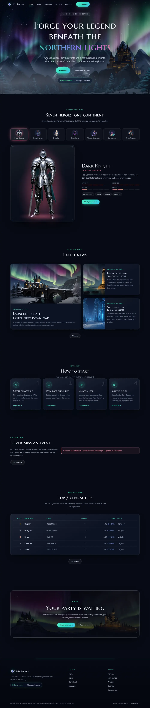](docs/assets/pages/home.webp) Strona główna | [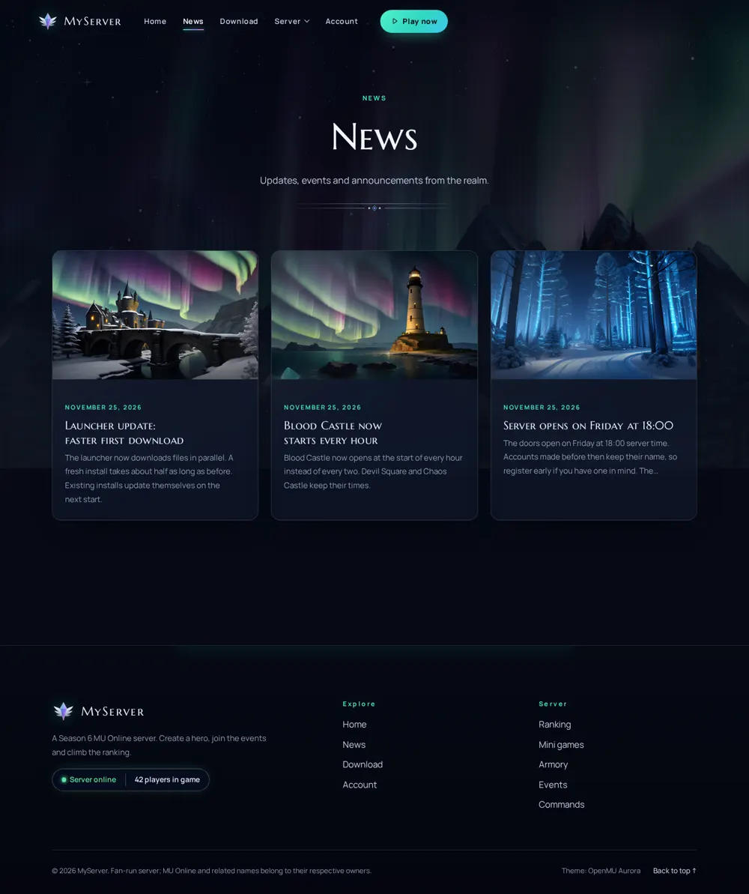](docs/assets/pages/news.webp) Aktualności | [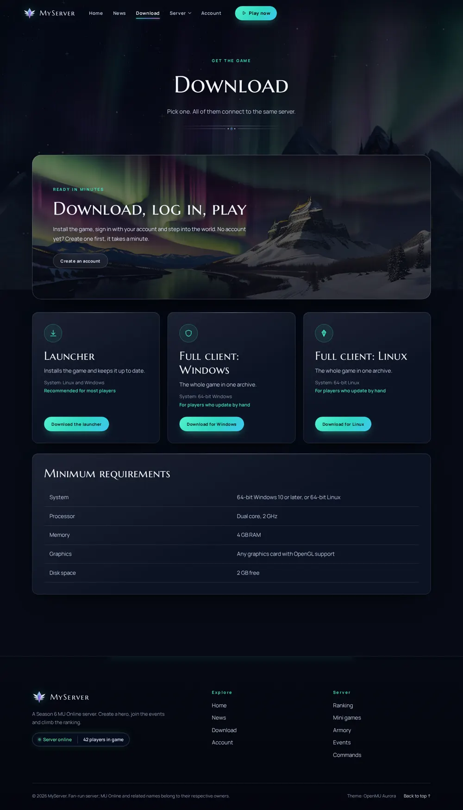](docs/assets/pages/download.webp) Pobierz |
| [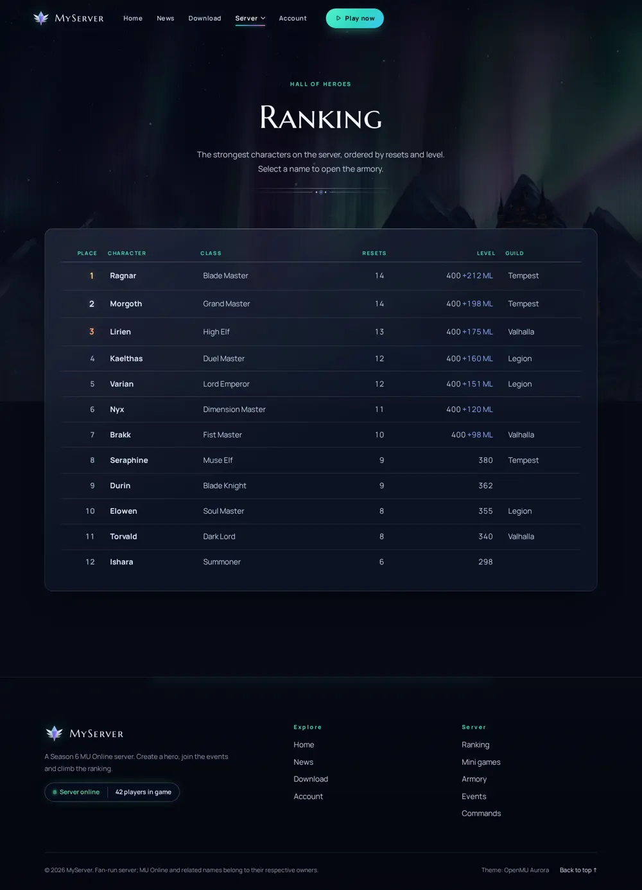](docs/assets/pages/ranking.webp) Ranking | [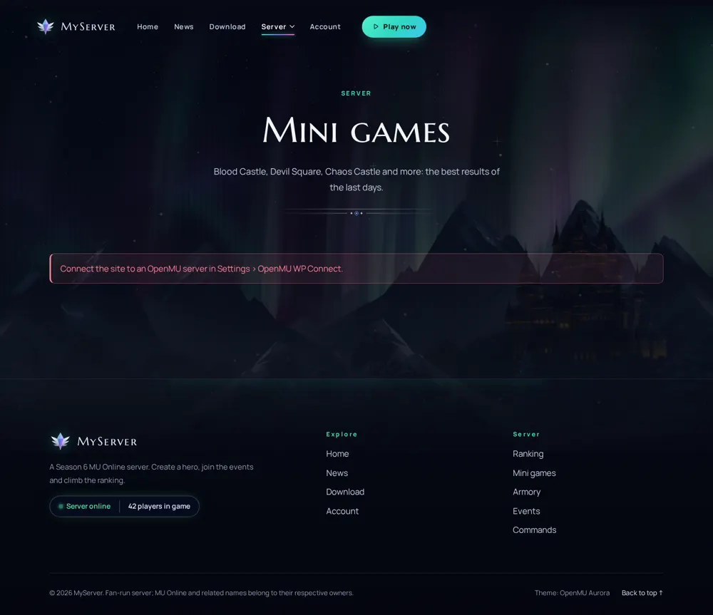](docs/assets/pages/mini-games.webp) Mini gry | [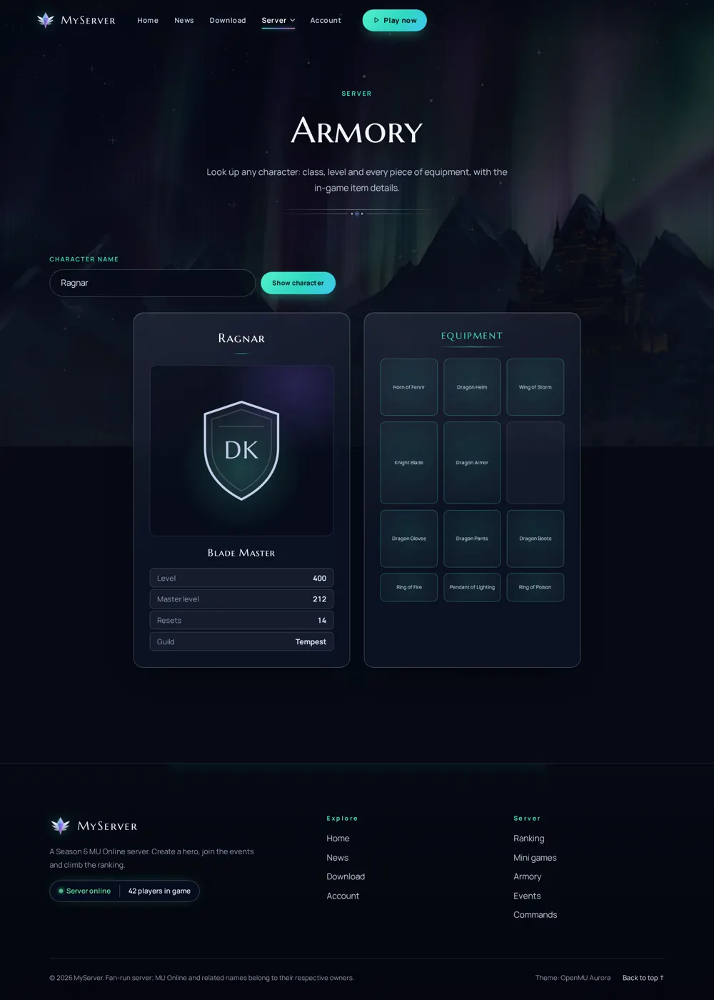](docs/assets/pages/armory.webp) Zbrojownia |
| [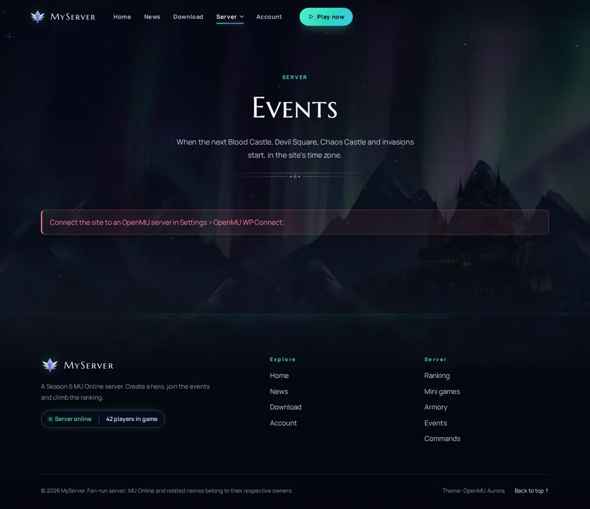](docs/assets/pages/events.webp) Wydarzenia | [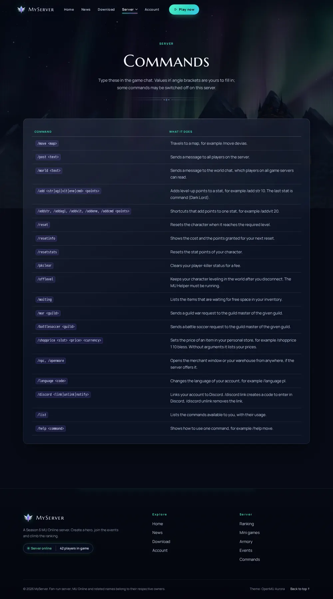](docs/assets/pages/commands.webp) Komendy | [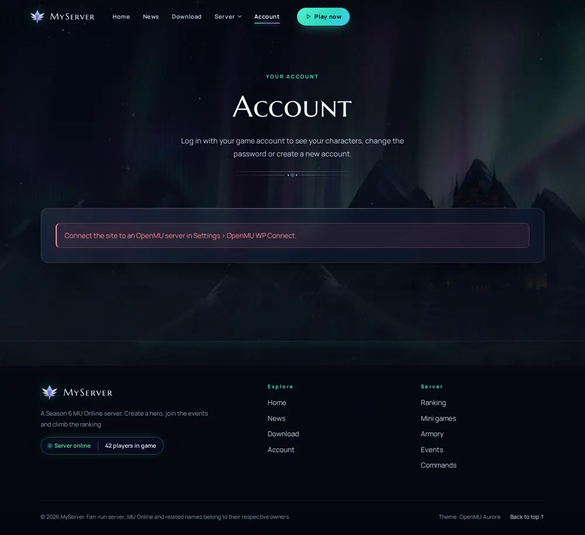](docs/assets/pages/account.webp) Konto |

| | | |
| --- | --- | --- |
| [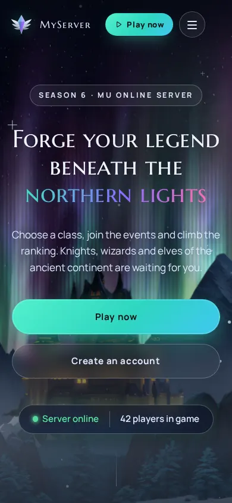](docs/assets/pages/phone-home.webp) Strona główna | [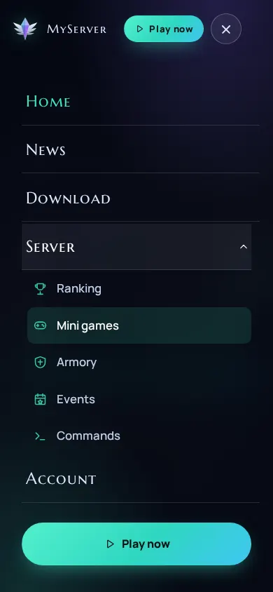](docs/assets/pages/phone-menu.webp) Menu | [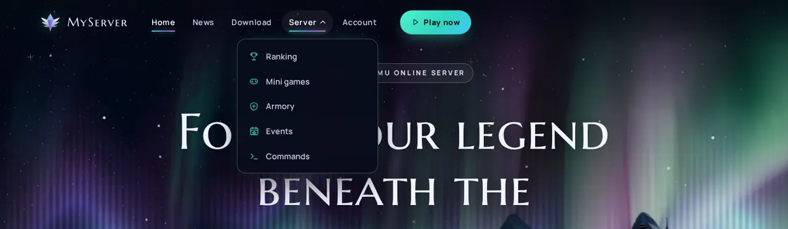](docs/assets/pages/menu-desktop.webp) Menu Serwer (desktop) |

## Grafiki i podziękowania

Malowane grafiki wygenerowano dla tego motywu modelem DreamShaper 8 (CreativeML OpenRAIL-M)
i powiększono Real-ESRGAN; jak, z jakimi ustawieniami i na jakich licencjach, opisuje
[`assets/art/README.md`](assets/art/README.md). Logo, ikony i ornamenty to ręcznie pisane SVG.
Czcionki: Marcellus SC i Manrope, SIL Open Font License 1.1 (`assets/fonts/`).

MU Online jest znakiem towarowym firmy Webzen. Ten projekt to praca fanowska, niezwiązana z Webzen ani przez nią niepopierana.

## Licencja

GPL-2.0-or-later. Copyright (c) 2026 Nolt.
